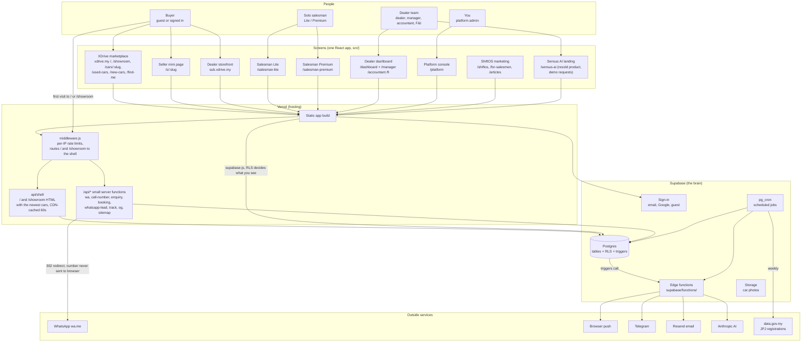
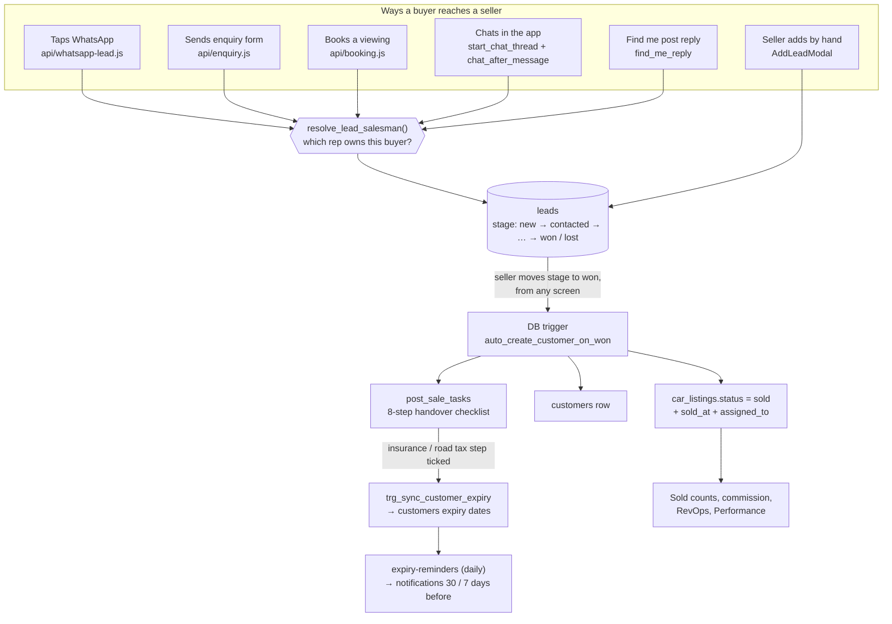
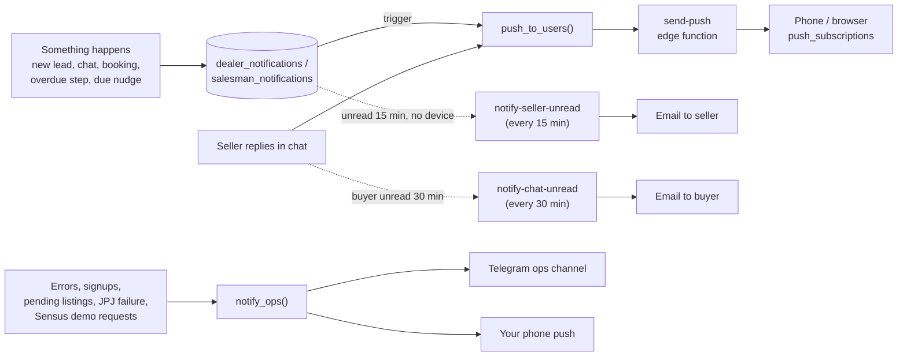
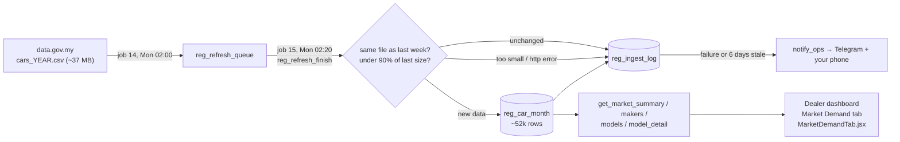
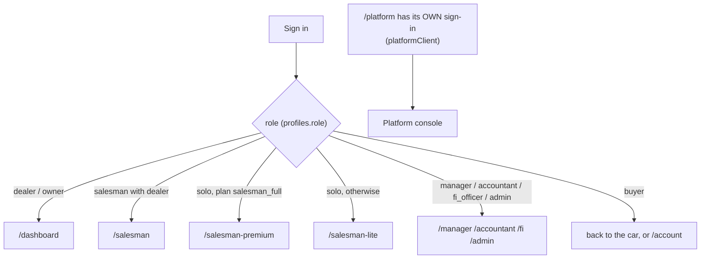
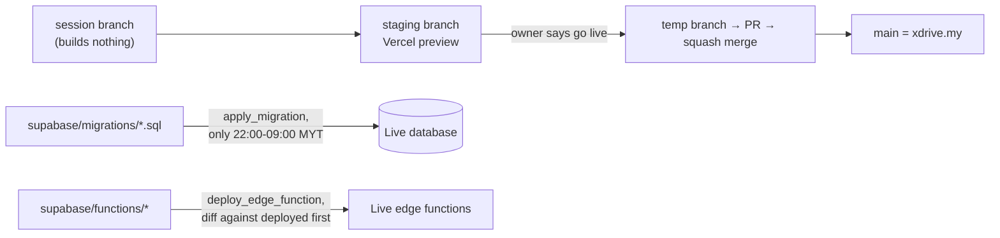

# ShiftOS / XDrive — how the system fits together

The one picture of the whole system. Diagrams are Mermaid (GitHub draws them).
**Update this file in the same commit as any change that adds a surface, a table
family, a background job or an outside service.** If it drifts, it is worse than
nothing. Rules and gotchas live in `CLAUDE.md`; this file is the map, not the rules.

Last checked against the live system: 2026-10-16.

---

## 1. The whole thing on one page

**Who actually uses each part** (accounts signed in during the last 30 days, 2026-10-16;
may include the owner's own test accounts):

| Part | Code size | Signed in, 30 days |
|---|---|---|
| Salesman Premium | `SalesmanPremium.jsx` 7,539 lines + `salesmanPremium/` | 6 |
| Salesman Lite | `SalesmanLite.jsx` 8,353 lines | 3 |
| Salesman under a dealer | `Salesmanpanel.jsx` 9,111 lines | 1 |
| Dealer dashboard | `DashboardPage.jsx` 12,161 lines | 1 dealer |
| Manager / accountant / F&I / admin panels | separate pages | 0 |
| Buyers (signed in + guests) | marketplace pages | 3 |
| Platform console | `AdminPage.jsx` + `components/platform/` | you |

Activity, same 30 days: 53 live cars, 36 leads, 5 chats, 4 cars sold, 0 subscription
payments logged (ever).

---

## 2. A buyer becomes a lead, a lead becomes a sale

The most important flow. Every way in ends at the same table (`leads`) and the same
salesman resolver; every win runs through the same database trigger.

Undoing a sale: only `undo_car_sale(listing_id)`; `trg_guard_sold_car` blocks anything else.

---

## 3. How someone gets told something happened

One rule: **insert a row into a notifications table and the push happens by itself.**

---

## 4. Scheduled jobs (pg_cron, live list)

| Job | When (UTC) | What it does |
|---|---|---|
| 3 notify-price-alerts | every 30 min | emails buyers when a new car matches a search they saved |
| 4 warm-leads-push | 09:00 daily | pushes dealers about leads idle 3+ days |
| 5 expiry-reminders-daily | 00:00 daily | road tax / insurance / overdue handover alerts |
| 6 cleanup-cron-logs | 03:00 daily | deletes cron run logs older than 24h |
| 7 appointment-reminders | every 5 min | Telegram reminder + nag for unconfirmed bookings |
| 8 expire-trial-subscriptions | 01:00 daily | marks old trials expired |
| 9 refresh-market-price-stats | hourly :07 | rebuilds `market_price_stats` |
| 10 purge-deleted-accounts-daily | 02:30 daily | hard-deletes accounts 30 days after deletion |
| 12 fire-due-nudges | every 5 min | turns due follow-up nudges into notifications |
| 13 notify-chat-unread | every 30 min | email buyers about unread seller replies |
| 14 jpj-refresh-fetch | Mon 02:00 | asks data.gov.my for this year's registrations file |
| 15 jpj-refresh-parse | Mon 02:20 | loads it into `reg_car_month`; alerts you on failure |
| 16 ask-viewing-outcomes | hourly :17, 01-13 | asks sellers how a past viewing went |
| 17 notify-seller-unread | every 15 min | email sellers about unseen leads |
| sweep-premium-lapses | hourly :41 | Premium ending in 3 days / ended pushes; hides cars over the Lite cap when Premium lapses (renewal unhides them) |

### JPJ data, end to end

---

## 5. Signing in and where you land

Data scoping: every dealer-side read/write uses `getDealerIdFromProfile(profile)`,
which must match the database's `get_my_dealer_id()`. RLS enforces it server side.

---

## 6. From code to production

The database and edge functions do not deploy with the app. A merged PR does not
change them; each is applied on its own.

---

## 7. Where to look

| Question | Start here |
|---|---|
| Why didn't a lead reach a rep? | `resolve_lead_salesman` (DB) |
| Why isn't a sale counted? | `auto_create_customer_on_won` trigger on `leads` |
| Why no push? | `push_subscriptions`, `push_to_users`, `send-push` |
| Who is live right now, by name? | `get_live_sellers()` (superadmin, reads `seller_live_state`), `src/hooks/useLiveSellers.js` (console Home) |
| Why didn't a screen update live? | `rt_notify` triggers -> private topics `rt:<table>:<col>:<value>` -> `src/lib/liveChannel.js` (re-reads the row through RLS; falls back to postgres_changes if a topic is refused). Topic rights: `rt_topic_allowed` |
| Who is online right now? | `online-now` Realtime presence channel: `src/components/OnlineBeacon.jsx` (every tab), `src/hooks/useOnlineNow.js` (console Home) |
| Which sellers have alerts on / the app on their home screen? | `get_account_reach`, `app_home_screen` (stamped by `src/hooks/useHomeScreenMark.js`), console > Accounts |
| Why is the marketplace blank? | `public_car_listings` view, `src/config/marketplaceConfig.js` |
| Why does Google show a generic page? | `api/og.js` |
| Why does / or /showroom paint cars before the app loads? | `api/shell.js` + `src/utils/serverSeed.js` |
| Loan / instalment numbers | `src/utils/financing.js` (the only formula) |
| What a buyer can see about a seller | `get_salesman_by_slug`, `sellerWaUrl` (`src/utils/sellerWhatsApp.js`) |
| Plans and caps | `plan_config`, `enforce_listing_cap`, `src/utils/planConfig.js` |
